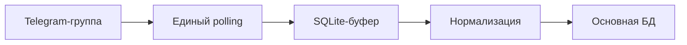
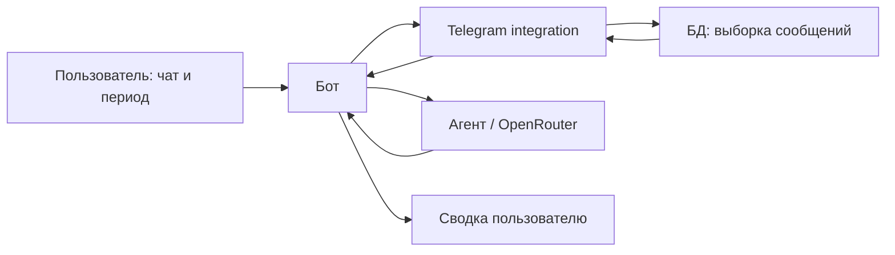

<div align="center">


# Academix

**Учебные чаты → сообщения в БД → сводка с домашними заданиями и дедлайнами**

Telegram-бот, который помогает студенту разобраться в переписке учебной группы.


[Возможности](#возможности) · [Запуск](#запуск-через-docker) · [Архитектура](#как-это-работает) · [LLM](#роль-llm) · [Команда](#команда)

</div>

---

## Возможности

| Возможность | Как работает |
| :--- | :--- |
| Сбор учебной переписки | Сохраняет новые сообщения и редактирования из групп и супергрупп, где состоит бот |
| Буфер событий | Групповые события сначала попадают в SQLite-буфер; после сбоя основной БД запись повторяется |
| Сводка за период | Пользователь выбирает чат, даты и пожелания к ответу |
| Структурированный результат | Обзор, домашние задания, сроки, важные сведения и неясности с указанием ID сообщений |

**Текущая версия — MVP для Telegram.** Подключение к LMS и автоматические напоминания пока не реализованы.

## Запуск через Docker

Понадобятся **Docker с Docker Compose**, токен Telegram-бота и ключ OpenRouter.

### 1. Подготовить настройки

Клонируйте репозиторий и перейдите в его корень:

```bash
git clone https://github.com/Noidor8/Academix.git
cd Academix
```

Создайте локальные файлы настроек. Команды для **PowerShell**:

```powershell
Copy-Item .env.example .env
New-Item -ItemType Directory -Force .local | Out-Null
Copy-Item agent.ini.example .local/agent.ini
```

Для **Linux / macOS**:

```bash
cp .env.example .env
mkdir -p .local
cp agent.ini.example .local/agent.ini
```

Если настройки уже существуют, отредактируйте их вместо повторного копирования.

| Файл | Что заполнить |
| :--- | :--- |
| `.env` | `BOT_TOKEN` — токен бота; при необходимости `BOT_TIMEZONE` и `BOT_PROXY` |
| `.local/agent.ini` | `api_key` — ключ OpenRouter; `model` — идентификатор модели |

Пример настройки агента:

```ini
[openrouter]
api_key=replace_with_your_openrouter_api_key
model=nvidia/nemotron-3.5-super-vl:free
```

В BotFather разрешите добавление бота в группы и отключите Privacy Mode, чтобы бот получал обычные сообщения группы. Добавьте бота в тестовую учебную группу. Для текущего запуска webhook должен быть отключён.

### 2. Запустить

Остановите ранее запущенный экземпляр бота: одному токену нужен один получатель updates.

```bash
docker compose up --build -d
```

Просмотр журнала:

```bash
docker compose logs -f bot
```

Остановка:

```bash
docker compose down
```

Основная БД и буфер хранятся в Docker volume `bot-data`, смонтированном в `/data`. Обычная остановка через `docker compose down` сохраняет volume; параметр `--volumes` удаляет его вместе с данными.

Compose задаёт пути `/data/academix.db` и `/data/telegram-inbox.sqlite3`. Локальные файлы из `.local/` на компьютере автоматически в эти базы не переносятся. Файл настроек агента подключается к контейнеру только для чтения.

> Токены, ключи, `.env`, `.local/`, базы и созданные отчёты не должны попадать в Git. Секреты указываются только в локальных файлах настроек.

## Как пользоваться

1. Отправьте несколько сообщений в группу, где состоит бот.
2. В личном чате с ботом отправьте `/summary`.
3. Введите числовой `chat_id` учебной группы.
4. Выберите `сегодня`, `вчера` или диапазон, например `2026-10-14 .. 2026-10-17`.
5. Добавьте пожелание, например «Выдели домашние задания», либо отправьте `пропустить`.

Бот вернёт сводку по уже сохранённым сообщениям. Начало периода включается, конец — нет: `[начало, конец)`. Часовой пояс по умолчанию — `Europe/Moscow`.

## Как это работает

**Сохранение групповых сообщений**



**Запрос сводки**



- **Telegram integration** получает события, нормализует сообщения и обращается к БД.
- **БД** сохраняет сообщения по ключу `(chat_id, message_id)`: редактирование обновляет ту же запись.
- **Бот** ведёт личный диалог и показывает результат. Личные команды не записываются в SQLite-буфер.
- **Агент** получает готовые сообщения, формирует запрос к модели и проверяет ответ. Самостоятельно к БД он не обращается.

## Роль LLM

| Параметр | Используемое решение |
| :--- | :--- |
| API-провайдер | [OpenRouter](https://openrouter.ai/) |
| Модель в примере конфигурации | [NVIDIA Nemotron 3.5 Super VL](https://openrouter.ai/nvidia/nemotron-3.5-super-vl:free) |
| Идентификатор | `nvidia/nemotron-3.5-super-vl:free` |
| Настройка | Поле `model` в `.local/agent.ini` |
| Системный промпт | [`src/academix_agent/system_prompt.txt`](src/academix_agent/system_prompt.txt) |

Модель получает текст сообщений выбранного чата за период и пожелание пользователя. Она выделяет домашние задания, сроки и важные сведения, чтобы студенту не приходилось перечитывать всю переписку.

Ответ запрашивается в JSON с полями `overview`, `homework`, `deadlines`, `key_points`, `uncertainties`. Агент проверяет структуру и идентификаторы сообщений-источников. В текущем сценарии мультимодальные возможности модели не используются: содержимое вложений не отправляется на распознавание.

Доступность модели и время ответа зависят от внешнего провайдера. При сетевой ошибке, превышении времени ожидания или некорректном ответе бот сообщает, что сводку получить не удалось. Генерация сводки не участвует в сохранении групповых сообщений.

## Структура репозитория

```text
Academix/
├── src/
│   ├── academix/
│   │   ├── bot/             # Диалог, валидация ввода, форматирование
│   │   ├── telegram/        # Сбор событий, буфер, мостик к БД
│   │   └── db/              # SQLite: сохранение и выборка сообщений
│   └── academix_agent/      # OpenRouter-клиент, промпт и проверка сводки
├── scripts/                 # Служебный запуск, диагностика, загрузка данных
├── tests/                   # Тесты БД и Telegram integration
├── Dockerfile               # Образ приложения
├── compose.yaml             # Запуск бота и постоянное хранение данных
├── .env.example             # Пример переменных окружения
├── agent.ini.example        # Пример настроек агента без секретов
└── requirements-bot.txt     # Зависимости приложения
```

<details>
<summary><strong>Служебные инструменты и тесты</strong></summary>

| Файл | Назначение |
| :--- | :--- |
| `scripts/run_telegram_receiver.py` | Отдельный приём Telegram updates без пользовательского диалога |
| `scripts/dispatch_telegram_messages.py` | Перенос накопленных событий из буфера в основную БД |
| `scripts/check_telegram_access.py` | Ручная проверка членства пользователя в группе |
| `scripts/telegram_ticket_01_probe.py` | Диагностика настроек бота и видов получаемых Telegram-событий |
| `scripts/make_fake_messages.py` | Генерация синтетических сообщений для работы с БД |
| `scripts/load_messages.py` | Загрузка сообщений из JSON в БД |

Самостоятельный receiver и диагностический probe получают updates. Не запускайте их параллельно с основным ботом на одном токене.

Для запуска тестов локально установите зависимости приложения и `pytest` в Python 3.11+:

```bash
python -m pip install -r requirements-bot.txt
python -m pip install pytest
python -m pytest -q tests
```

</details>

## Границы MVP

- Собираются новые события, полученные ботом; загрузки всей прежней истории группы нет.
- Сообщения, ещё ожидающие переноса из буфера в основную БД, пока не участвуют в сводке.
- Проверка членства реализована в `telegram/access.py`, но не подключена к выдаче сводки в MVP. Используйте тестовые группы и учитывайте это при доступе к переписке.
- Агент отклоняет контекст больше 100 000 символов; для большого чата нужно выбрать меньший период.
- Состояние личного диалога находится в памяти и сбрасывается при перезапуске.

## Команда

| Участник | GitHub | Основная часть |
| :--- | :--- | :--- |
| Муцольгов Родион Хасанович | [@Noidor8](https://github.com/Noidor8) | Telegram integration |
| Тишутин Павел Сергеевич | [@PavelTishutin](https://github.com/PavelTishutin) | База данных |
| Лычагин Илья Витальевич | [@ilyalychagin](https://github.com/ilyalychagin) | LLM-агент |
| Гаврилюк Тимофей Александрович | [@timagavr](https://github.com/timagavr) | Пользовательский Telegram-бот |
