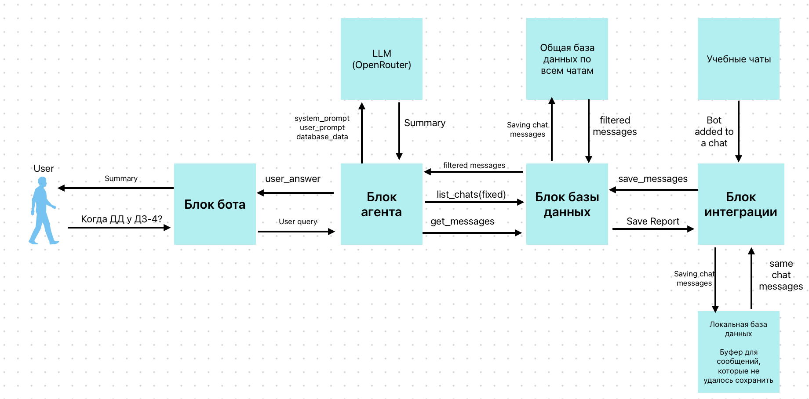

# Academix · помощник студента по учебным чатам


Telegram-бот, который собирает сообщения из учебных групп в базу данных и по запросу студента присылает сводку за выбранный период: домашние задания, сроки и важные объявления. Сводку составляет LLM через OpenRouter, а у каждого пункта указаны сообщения, из которых он взят.

[Системный промпт модели](src/academix_agent/system_prompt.txt) · [Переменные окружения](.env.example) · [Настройки модели](agent.ini.example)

## Что умеет

- Сохраняет новые сообщения и их правки из групп и супергрупп, куда добавлен бот. Правка обновляет ту же запись по ключу `(chat_id, message_id)`, а старая версия, пришедшая повторно, не затирает более свежую правку.
- Не теряет сообщения при сбое базы: события сначала попадают в буфер SQLite и переносятся в основную базу пачками, а неудачная пачка остаётся в буфере до следующей попытки.
- В личном чате по команде `/summary` спрашивает `chat_id` группы, период (`сегодня`, `вчера` или диапазон `2026-10-14 .. 2026-10-17`) и пожелание к сводке. 
- Присылает сводку из пяти разделов: обзор, домашние задания, сроки, важные сведения и неясности. У каждого пункта указаны ID сообщений-источников.
- Если ответ модели не проходит проверку (не тот формат или ссылка на сообщение, которого не было в чате), бот сообщает, что сводку получить не удалось, и не показывает непроверенный ответ.

## Какая LLM и зачем

- **Провайдер:** [OpenRouter](https://openrouter.ai/), запрос `POST /chat/completions` с ответом в формате JSON. Модель задаётся полем `model` в `.local/agent.ini`. Сейчас это `nvidia/nemotron-3.5-super-vl:free`.
- **Что делает модель:** получает сообщения выбранного чата за период (ID, время, автор, текст) и пожелание студента. Возвращает JSON с полями `overview`, `homework`, `deadlines`, `key_points` и `uncertainties`, и у каждого пункта есть `authors`. Агент проверяет структуру ответа и отклоняет его, если модель сослалась на сообщение, которого не было во входных данных. Системный промпт лежит в [`src/academix_agent/system_prompt.txt`](src/academix_agent/system_prompt.txt).
- **Зачем LLM:** задания и сроки в учебных чатах пишут свободным текстом: «сдаём до пятницы», «перенесли на понедельник», уточнения в ответах на другие сообщения. Правилами и регулярными выражениями это надёжно не разобрать, потому что нужно понять, к какому заданию относится перенос и от какой даты считать «до пятницы». Модель делает только эту часть. Сбор, хранение и выборку сообщений выполняет обычный код без LLM.
- **Почему эта модель:** она доступна бесплатно через OpenRouter, поэтому MVP запускается без оплаты. Модель меняется одной строкой в `.local/agent.ini` без правки кода. Мультимодальные возможности модели пока не используются: вложения в неё не передаются.

## Как устроено



**Сбор сообщений (в фоне):** группа в Telegram → long polling в `telegram/receiver.py` → буфер `telegram-inbox.sqlite3` → `telegram/dispatch.py` → `academix.db.save_messages` → таблица `messages` в `academix.db`.

**Сводка (по запросу):** `/summary` в личном чате → `bot/handlers.py` → `bot/service.py` → `academix_agent` → `academix.db.get_messages` → `academix_agent` → OpenRouter → `bot/formatting.py` → ответ студенту.

| Файл | Назначение |
|---|---|
| `src/academix/bot/__main__.py` | Точка входа: `python -m academix.bot` запускает бота |
| `src/academix/bot/handlers.py` | Диалог `/summary`: `chat_id`, период и пожелание; команды `/help` и `/cancel` |
| `src/academix/bot/validation.py` | Проверка `chat_id` и разбор периода (`сегодня`, `вчера`, диапазон дат) |
| `src/academix/bot/service.py` | Сценарий сводки: вызов агента с параметрами запроса, общий тайм-аут |
| `src/academix/bot/integration.py` | Связь бота с агентом, чтение `.local/agent.ini` |
| `src/academix/bot/formatting.py` | Оформление сводки и разбиение длинного ответа на сообщения Telegram |
| `src/academix/bot/config.py` | Настройки бота из переменных окружения |
| `src/academix/telegram/receiver.py` | Клиент Telegram Bot API и единый long polling: группы идут в буфер, личные сообщения — в диалог бота |
| `src/academix/telegram/inbox.py` | Буфер событий в SQLite: исходные updates, offset, список групп |
| `src/academix/telegram/normalize.py` | Преобразование Telegram update в сообщение из 11 полей |
| `src/academix/telegram/dispatch.py` | Перенос событий из буфера в базу пачками с повтором при ошибке |
| `src/academix/telegram/contracts.py` | Формат сообщения `TelegramMessageV1` и интерфейс хранилища |
| `src/academix/telegram/access.py` | Проверка, состоит ли пользователь в группе (пока не подключена) |
| `src/academix/db/storage.py` | Работа с SQLite: `save_messages`, `get_messages`, `list_chats` |
| `src/academix/db/queries.py` | Схема таблицы `messages` и все SQL-запросы |
| `src/academix/db/normalize.py` | Проверка ключа, приведение типов, перевод дат в UTC |
| `src/academix/db/models.py` | Поля сообщения и отчёт о сохранении `SaveReport` |
| `src/academix_agent/agent.py` | Выборка сообщений из БД, клиент OpenRouter, сборка промпта и проверка JSON-ответа модели |
| `src/academix_agent/system_prompt.txt` | Системный промпт модели |
| `scripts/run_telegram_receiver.py` | Отдельный приём событий без диалога с пользователем |
| `scripts/dispatch_telegram_messages.py` | Ручной перенос событий из буфера в базу |
| `scripts/check_telegram_access.py` | Ручная проверка членства пользователя в группе |
| `scripts/telegram_ticket_01_probe.py` | Диагностика настроек бота и типов событий Telegram |
| `scripts/make_fake_messages.py` | Выдуманные сообщения трёх учебных чатов в JSON для разработки и демо |
| `tests/test_agent.py` | Тесты агента с подменённым LLM: формат ответа, порядок сообщений, границы периода, проверка ID источников и обработка ошибок |
| `scripts/load_messages.py` | Загрузка сообщений из JSON в базу через `save_messages` |
| `tests/test_storage.py`, `tests/fake_data.py` | Тесты базы данных и генератор выдуманных сообщений для тестов и демо |
| `tests/test_telegram_pipeline.py` | Тесты Telegram integration: формат, нормализация, буфер, перенос в базу, приём событий |
| `Dockerfile`, `compose.yaml` | Образ бота и запуск с постоянным хранилищем данных |
| `.env.example`, `agent.ini.example` | Примеры настроек без секретов |

## Запуск через консоль

Предполагается Python 3.11 или новее.

```bash
git clone https://github.com/Noidor8/Academix.git
cd Academix
python -m venv .venv
source .venv/bin/activate               # Windows: .venv\Scripts\activate
pip install -r requirements-bot.txt

cp .env.example .env                    # вписать BOT_TOKEN
mkdir -p .local
cp agent.ini.example .local/agent.ini   # вписать api_key OpenRouter

set -a; source .env; set +a             # загрузить переменные из .env в текущий терминал
PYTHONPATH=src python -m academix.bot   # запустить бота
```

В PowerShell вместо двух последних строк:

```powershell
$env:BOT_TOKEN = "<токен бота>"
$env:PYTHONPATH = "src"
python -m academix.bot
```

Остальные переменные из `.env.example` необязательны: по умолчанию базы создаются в `.local/`, часовой пояс `Europe/Moscow`.


## Тесты

```bash
pip install pytest

python -m pytest -q tests                             # весь проект
python -m pytest -q tests/test_storage.py             # база данных
python -m pytest -q tests/test_telegram_pipeline.py   # Telegram integration
```

Тесты работают офлайн без Telegram, OpenRouter и сети, каждая база создаётся во временной папке. 

## Ограничения MVP

На текущем этапе бота можно добавить в учебную группу, участники пишут туда сообщения, а студент в личном чате с ботом запрашивает по ним сводку. Предстоит дальнейшее масштабирование и расширение архитектуры и функционала бота.

- Работа с несколькими студентами одновременно в MVP не проверялась. Чат выбирается вручную по `chat_id`. Проверка того, что студент состоит в группе, есть в `telegram/access.py`.
- Бот видит сообщения, пришедшие после его добавления в группу, поэтому не загружает прежнюю историю чата.
- Из вложений и приложений к заданиям сохраняется имя файла, содержимое документов и изображений модель не получает.
- Бесплатная модель на OpenRouter может отвечать медленно или быть временно недоступна. Общий тайм-аут сводки — 60 секунд.
- Код проверяет формат ответа и то, что модель ссылается только на реально существующие сообщения. 
- Состояние диалога хранится в памяти и сбрасывается при перезапуске бота. У одного пользователя одновременно обрабатывается только один запрос.
- Сейчас бот работает на компьютере разработчика без постоянного размещения на сервере, его запускают из консоли, а сборка и запуск через Docker Compose тоже проверены.
- Для проверки имеются тестовые группы и синтетические данные. Токены, ключи, `.env`, `.local/` и базы данных в Git не попадают.

Пример получения сводки:

1. Напишите несколько сообщений в группе, где состоит бот.
2. Узнайте `chat_id` группы, можно посмотреть напрямую в локальной базе данных или выполнить команду ниже из корня проекта:
   ```bash
   PYTHONPATH=src python -c "from academix.db import list_chats; print(list_chats())"
   ```
3. В личном чате с ботом отправьте `/summary`, затем `chat_id`, период и пожелание (или «пропустить»).

Чтобы попробовать сводку без живой группы, загрузите синтетическую переписку трёх учебных чатов:

```bash
python scripts/make_fake_messages.py                        # .local/fake_messages.json
python scripts/load_messages.py .local/fake_messages.json   # записать в .local/academix.db
```

После этого запросите сводку по `chat_id` `-1001000000001` («Линейная алгебра 2026») за период `2026-09-01 .. 2026-10-31`.


## Запуск в Docker

Перед запуском:

```bash
cp .env.example .env                    # вписать BOT_TOKEN
mkdir -p .local
cp agent.ini.example .local/agent.ini   # вписать api_key OpenRouter
```

Также настройте бота в BotFather, как описано в разделе «Запуск через консоль», и остановите локальную копию бота, если она запущена. Файл `.local/agent.ini` обязателен: `compose.yaml` подключает его в контейнер только для чтения, и без него контейнер не запустится.

```bash
docker compose build                    # собрать образ academix-bot:local
docker compose up -d                    # запустить бота в фоне
# или одной командой: docker compose up --build -d

docker compose logs -f bot              # журнал
docker compose exec bot python -c "from academix.db import list_chats; print(list_chats())"   # chat_id групп
docker compose down                     # остановить
```

Основная база и буфер лежат в volume `bot-data` (папка `/data` в контейнере) и сохраняются между перезапусками. Команда `docker compose down --volumes` удаляет их вместе с данными. В образ попадает только папка `src/`, поэтому тесты запускаются локально, как в разделе «Тесты».

## Команда

| Участник | GitHub | Часть проекта |
|---|---|---|
| Муцольгов Родион Хасанович | [@Noidor8](https://github.com/Noidor8) | Сбор сообщений из Telegram |
| Тишутин Павел Сергеевич | [@PavelTishutin](https://github.com/PavelTishutin) | База данных |
| Лычагин Илья Витальевич | [@ilyalychagin](https://github.com/ilyalychagin) | LLM-агент |
| Гаврилюк Тимофей Александрович | [@timagavr](https://github.com/timagavr) | Пользовательский Telegram-бот |
